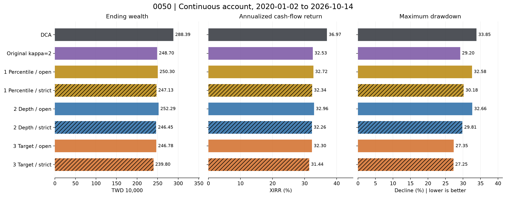
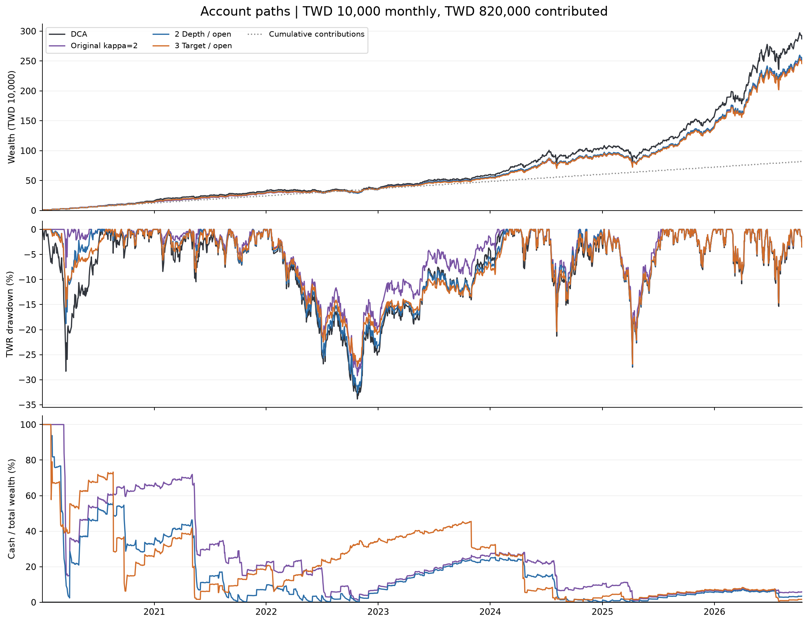
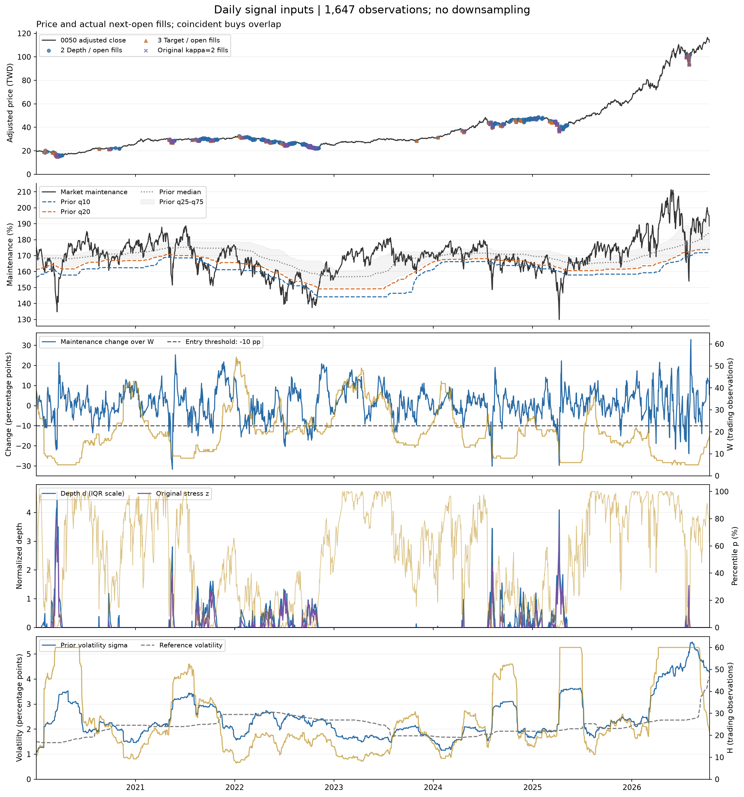
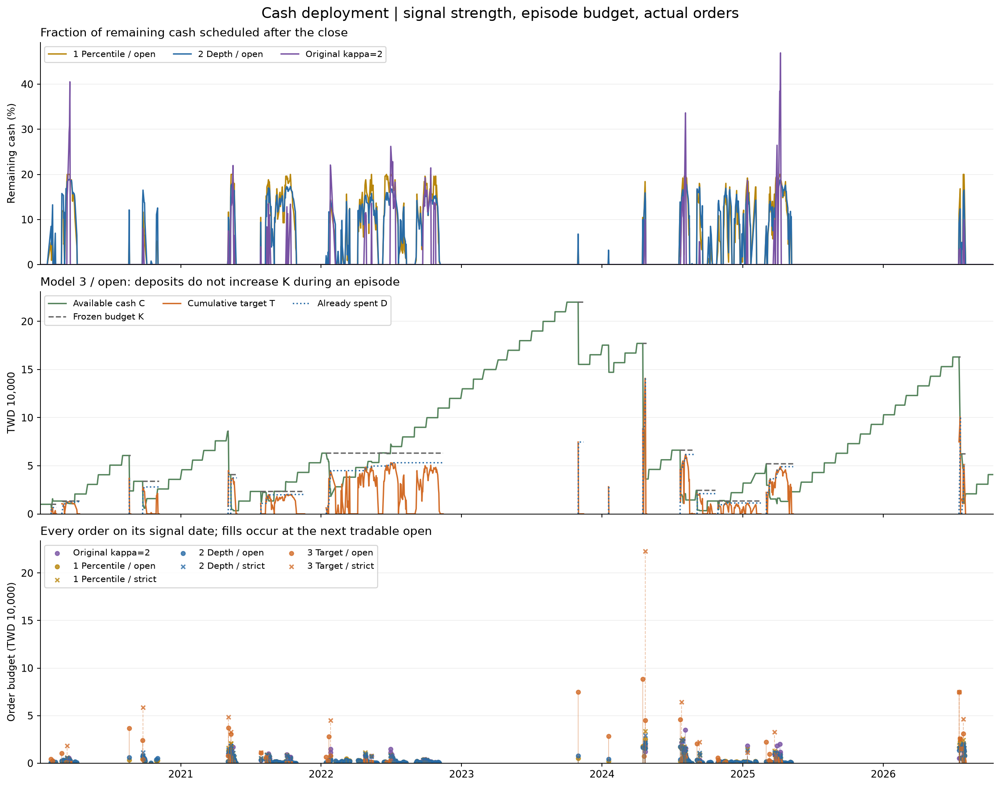

# 0050 Margin-Maintenance Signal Research

Saved results for testing whether market-wide margin-maintenance signals can improve on monthly dollar-cost averaging (DCA) in Taiwan's 0050 ETF.

**Result: none of the 48 predefined candidate configurations beat DCA while also keeping maximum drawdown no larger in the continuous 2020–2026 test.** The best candidate by ending wealth was the depth model without the original strict entry filter: TWD 2,522,905 versus DCA's TWD 2,883,912.

This is a historical research result for the tested rules and parameter range, not proof that every margin-based strategy must fail. The proposed **DCA plus occasional investment of extra cash has not been backtested here**. All strategy results below use the previous pure-strategy accounts with equal monthly funding.

## Continuous 2020–2026 result

- Portfolio dates: **2020-01-02 through 2026-10-14**, 1,647 daily observations.
- Funding: **TWD 10,000 each month**, 82 deposits, **TWD 820,000 total**.
- Cash, holdings, and active episode state carry across the entire period; there is **no reset in 2024**.
- Candidate parameters were selected using **2016–2019 only**, then held fixed. The later periods had already been examined during research, so this is an exploratory chronological holdout, not a completely unseen out-of-sample test.

Amounts below are TWD; maximum drawdown is shown as a positive decline magnitude, so smaller is better. Ending wealth includes uninvested cash. Annualized return is XIRR using the actual contribution dates.

| Model | Original entry filter | Ending wealth | XIRR | Maximum drawdown | Ending cash | Average cash / wealth |
|---|---|---:|---:|---:|---:|---:|
| DCA | — | 2,883,912 | 36.97% | 33.85% | 0 | 0.00% |
| Original formula, κ=2 | Strict | 2,486,994 | 32.53% | 29.20% | 145,535 | 23.99% |
| 1. Percentile | Strict | 2,471,298 | 32.34% | 30.18% | 92,993 | 22.93% |
| 1. Percentile | Open | 2,502,973 | 32.72% | 32.58% | 72,788 | 16.75% |
| 2. Depth | Strict | 2,464,537 | 32.26% | 29.81% | 111,150 | 23.46% |
| 2. Depth | Open | 2,522,905 | 32.96% | 32.66% | 86,598 | 15.21% |
| 3. Cumulative target | Strict | 2,397,998 | 31.44% | 27.25% | 40,858 | 24.67% |
| 3. Cumulative target | Open | 2,467,789 | 32.30% | 27.35% | 40,857 | 21.75% |

**Strict** retains the old entry filter in addition to the new formula. **Open** removes that filter but still requires the new formula's own low-maintenance condition. These are different entry policies, not just different cash-sizing formulas.



The depth/open model finishes **TWD 361,008 (12.52%) below DCA**, while reducing maximum drawdown by only **1.19 percentage points**. Cumulative target/open deploys more principal than depth/open (TWD 779,143 versus TWD 733,402) but finishes with less wealth; the amount eventually invested alone does not explain performance. Timing and prices paid also matter.



The performance-path figure focuses on DCA, the original κ=2 formula, depth/open, and target/open for legibility. The summary table and CSV files retain all eight accounts.

## Signal inputs and actual buying

All figures retain daily observations; there is no time downsampling. Price marks use actual next-tradable-open fills, while order amounts are plotted on the preceding signal date. Prices are dividend/split-adjusted equivalents consistent with the backtest, not historical unadjusted exchange quotes. Coincident buy markers can overlap.



The maintenance figure includes the prior q10, q20 and median, with the q25–q75 range shaded. On the change, depth and volatility panels, the gold curve uses the right-hand axis: window W, historical percentile p and allocation horizon H, respectively. The price panel shows depth/open, target/open and the original formula; every model's orders are shown below and saved in the trade ledger.



For model 3, **K** is the fixed episode budget, **T** the current cumulative spending target, **D** cost-inclusive spending already executed in that episode, and **C** cash. New deposits do not enlarge K until the next episode. K/T/D are absent when no episode is active. Strict variants use dashed stems and cross markers in the order panel; open variants use solid stems and circles.

This budget rule can leave cash unavailable for an active signal. For example, in the 2020–2023 test, the target/open episode ran from **2022-01-14 to 2022-11-15** with K of about **TWD 63,128**. By 2022-10-25, about **TWD 53,160** had been spent in the episode, while total cash was about **TWD 99,968**. Later deposits could not expand that episode's budget. This is a limitation of the tested funding policy, not a rejection of every cumulative-target design.

## Models and fixed parameters

Let `m[t]` be today's maintenance ratio, expressed in percentage points, and `C[t]` available cash after today's activity. All rolling reference statistics use the **252 observations strictly before t**. Orders include the buying fee in their cash budget.

### 1. Historical percentile

```text
p[t] = mean(m[t-i] <= m[t], i=1,...,252)
B[t+1] = C[t] × a × max(0, 1 - p[t]/p0)^r
Selected: p0 = 0.20, a = 0.20, r = 1
```

### 2. Low-maintenance depth

```text
d[t] = max(0, (q20[t] - m[t]) / max(q75[t] - q25[t], 0.000001))
B[t+1] = C[t] × a × d[t] / (h + d[t])
Selected: a = 0.20, h = 0.25
```

The epsilon is in maintenance-ratio percentage points. Both models can keep spending while the ratio stays low; they do not require a new low each day.

### 3. Cumulative spending target

```text
T[t] = K × d[t] / (h + d[t])
B[t+1] = min(C[t], max(0, T[t] - D[t]))
Selected: h = 0.25
```

An episode starts at the first `d > 0` while inactive and ends when `m >= prior q50`. K is frozen at episode start; D accumulates actual cost-inclusive fills. Episode boundaries are independent of the strict filter, which only controls order eligibility. New deposits wait for a later episode; a falling target never causes a sale. If the account starts during a low period, its first positive-depth close starts its first episode. Cash reserved for an outstanding order is excluded from a new episode's available budget.

### Original strict filter and κ=2 baseline

```text
sigma[t]     = standard deviation of the previous 60 daily changes in m
sigma_ref[t] = median of the previous 252 sigma observations
W[t]         = round(clip(20 × (sigma_ref[t]/sigma[t])², 5, 60))
Strict entry = m[t] < prior q10 AND m[t] - m[t-W[t]] < -10 percentage points

z[t] = max(0, (q10[t] - m[t]) / (sigma_ref[t] × sqrt(20)))
H[t] = clip(20 × (sigma[t]/sigma_ref[t])², 5, 60)
B[t+1] = C[t] × (1 - exp(-2 × (1 + z[t]²) / H[t])) when strict entry holds
```

All required historical statistics must be available before trading. W and H have different roles and inverse volatility ratios: W measures the entry-price-change window; H controls the cash-spending rate. These formulas are heuristic rules, not estimated probabilities or proven optimal allocations.

## Evaluation and assumptions

- All strategy accounts are **buy-only, unlevered, with no core DCA sleeve**. DCA is a separate fully invested benchmark.
- Deposits arrive before the first tradable open each month. A closing signal freezes an order budget for the next tradable ETF open. An outstanding order waits through an ETF suspension.
- Buying fee: **0.1425%**, deducted within the order budget. No sales occur. Cash interest, minimum commissions, bid/ask spreads and dividend taxes are omitted.
- Fractional adjusted total-return units approximate dividend reinvestment. Actual integer-share execution and cash dividend handling may differ.
- XIRR uses dated deposits and terminal wealth. Maximum drawdown uses daily-close TWR, splitting contribution-day returns at the open to remove external cash-flow effects. It includes an initial index peak of 1 and does not measure intraday drawdown.
- Training: 2016–2019. Separate later tests: 2020–2023 and 2024–2026-10-14, each with a fresh account. The continuous test carries the account across both later periods.
- Predeclared grid: 24 percentile configurations, 18 depth configurations and 6 cumulative-target configurations, including both entry-filter choices. Within each family/filter, select the highest training ending wealth among candidates with no worse drawdown than DCA. The full grid is diagnostic in later periods; parameters are not reselected there.
- No candidate in the grid met both objectives in training, either separate later test, or the continuous later test. This finding is limited to the chosen datasets, rules and parameter range.

## Data and validation

Signals use the user-approved **FinLab combined TWSE + TPEx** maintenance series, which differs from the earlier listed-only iStock series. Prices use saved Yahoo data with official TWSE corrections. The source aggregate's historical publication time and revisions cannot be independently reconstructed; next-open trading assumes the closing signal was available in time.

- [FinLab maintenance-ratio source](https://finlab.finance/tools/margin-maintenance-ratio)
- [TWSE historical daily stock prices](https://www.twse.com.tw/zh/trading/historical/stock-day.html)
- [Data-quality notes](backtest/direct_models/data_quality.json) and [222 official monthly OHLC comparisons](backtest/direct_models/official_price_checks.csv).
- Eleven additional missing/incorrect dates were repaired, including 2024-01-15's spurious zero-volume row; earlier reviewed repairs are also retained. All source snapshots used by preparation remain local. Pre-2014 Yahoo price scaling is excluded.
- [Engine and prefix checks](backtest/direct_models/validation.csv): 36 checks reconcile the established engine and verify that removing future observations does not change earlier results.
- [Order/episode audit](backtest/direct_models/order_validation.csv): 18 selected model/period combinations have independently checked sizing arithmetic, actual fills, fees, and frozen episode budgets.
- [Continuous-prefix checks](backtest/direct_models/continuous_validation.csv): all eight continuous accounts match their previously saved 2020–2023 paths; DCA terminal wealth also passes an independent holdings calculation.
- [Figure manifest](backtest/direct_models/saved_results_manifest.json) records input and image SHA-256 hashes and plotting-library versions. Figure generation checks terminal wealth and drawdown against the summary for all eight accounts.

## Saved results

| File | Contents |
|---|---|
| [Continuous summary](backtest/direct_models/continuous_2020_2026_summary.csv) | Six selected candidates, original formula and DCA |
| [Continuous full grid](backtest/direct_models/continuous_2020_2026_grid.csv) | All 48 candidates plus the two baselines |
| [Year-end account values](backtest/direct_models/continuous_annual.csv) | Continuous accounts at each year end; 2026 ends October 14 |
| [Separate-period summary](backtest/direct_models/selected_summary.csv) | Training and the two separate later-period tests |
| [Parameter robustness](backtest/direct_models/robustness.csv) | All-grid ranges and success counts by model/filter/period |
| [All daily signal values](backtest/direct_models/all_signal_values_daily.csv) | Features, order/fill amounts, cash and episode state for the seven strategy accounts |
| [All model buys](backtest/direct_models/all_model_buys.csv) | Signal dates, execution dates, fee-inclusive spend, fees and adjusted units |
| [Signal counts](backtest/direct_models/all_signal_counts.csv) | Orders, executed buy days and total spending |
| [Trough cash](backtest/direct_models/trough_cash.csv) | Cash and episode budgets on each separate period's DCA drawdown trough |
| [Predeclared experiment](backtest/direct_models/design.json) | Candidate grid, selection and episode rules |
| [Frozen parameters](backtest/direct_models/selected_before_tests.json) | Parameters selected before later-period evaluation |
| [Continuous-account rules](backtest/direct_models/continuous_rules.json) | Funding and carry-over conventions |

Detailed `*_daily.csv`, `*_orders.csv`, `*_trades.csv` and `*_episodes.csv` ledgers remain in [backtest/direct_models](backtest/direct_models). Earlier exploratory experiments in other folders are retained for provenance; they include superseded sell-enabled policies and should not be confused with the buy-only results presented here.

## Reproduce

From the repository root, create a Python environment and install the recorded dependencies:

```bash
python3 -m venv .venv
.venv/bin/python -m pip install -r backtest/direct_models/requirements.txt
```

Regenerate only the README figures from saved results:

```bash
.venv/bin/python backtest/direct_models/render_saved_results.py
```

To recompute the full experiment from the saved local source snapshots:

```bash
.venv/bin/python backtest/direct_models/prepare.py
.venv/bin/python backtest/direct_models/run.py
.venv/bin/python backtest/direct_models/verify.py
.venv/bin/python backtest/direct_models/continuous.py
.venv/bin/python backtest/direct_models/plot_signals.py
.venv/bin/python backtest/direct_models/render_saved_results.py
```

These scripts use local files and do not fetch market data or place trades. The original engine dependencies in sibling backtest folders must remain in the repository. `plot_signals.py` regenerates the consolidated CSVs and portable chart-input JSON under `backtest/direct_models/chart_inputs`; the README PNGs require only Matplotlib and do not depend on Codex's inline visualization runtime.

## Interpretation and next research step

Waiting for a low-maintenance signal reduced exposure and often drawdown, but did not offset the missed market participation in these tests. The practical discussion therefore shifted toward continuing regular DCA and using signals as a reference for genuinely additional investable cash. That proposal remains **untested**: any fair comparison must give its benchmark the same extra cash on the same dates.

A separate untested model refinement would let new deposits enlarge the current cumulative-target budget without resetting already-spent D. Neither that refinement nor a claim of superior future returns is included in the saved results.
